# Firstlight

Finds graduate and junior engineering roles on company job boards across Europe, scores each one against a candidate's profile with Claude, and tracks every application in a local web app.

[](https://github.com/andrei29git/firstlight/actions/workflows/ci.yml)
[](LICENSE)
[](https://www.python.org/)

<picture>
  <source media="(prefers-color-scheme: dark)" srcset="docs/images/jobs-dark.png">
  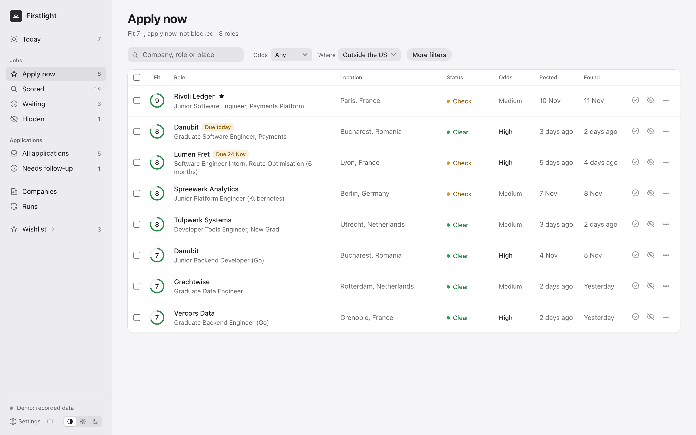
</picture>

## The problem

For a graduate engineering application, two things do most for the odds: applying in the first few days after a role is posted, and getting a referral. By the time a role reaches LinkedIn or the big aggregators, those first days are usually gone, and the useful roles are buried under senior positions, other countries and other fields.

Company job boards publish roles first. So Firstlight reads the boards themselves, at thousands of companies, removes what clearly does not fit, asks a model to judge the rest against one candidate's profile, and puts the handful worth acting on at the top of a small web app. It never applies on its own: a person makes every submission.

## Features

- **Roles straight from company job boards**: Greenhouse, Lever, Ashby, Workday, Recruitee, SmartRecruiters, Personio, Workable, Teamtailor, Homerun, Oracle, Avature, Eightfold, and custom career sites (sitemaps, schema.org `JobPosting` data or plain listing pages).
- **About 17,000 companies**, discovered in the [Common Crawl](https://commoncrawl.org) index, checked live, and kept only if they have a role in an allowed country.
- **A score for every role**: fit from 0 to 10, blockers listed beside it (language, enrolment, experience and so on), odds, a suggested action, what to lead with and the gaps.
- **An application tracker** that replaces a spreadsheet: stages with their history, next steps, follow-ups after 21 days of silence, and per-company application limits.
- **Application help**: drafts answers to application questions and a cover letter from the profile only. Anything the profile does not say becomes a placeholder to fill in, never an invented fact.
- **Runs on a schedule** on GitHub Actions every two hours, with a laptop job for the few sites that refuse cloud servers.
- **A local, Mac-style web app** (FastAPI, Jinja2 and htmx) in light and dark mode, with keyboard shortcuts.
- **One threshold for what matters**: the Apply now threshold on the Settings page also decides which roles reach your phone, so the two always agree.

## Quick start

The demo runs on an invented candidate and invented companies. Every score, drafted answer, cover letter and chat reply is pre-recorded, and the demo makes no network or Claude calls, so it needs no Claude subscription.

```sh
git clone https://github.com/andrei29git/firstlight.git
cd firstlight
uv sync
uv run jobhunt serve --demo
```

Then open <http://127.0.0.1:8001>. The demo has its own port, so its settings never mix with your own app's on 8000. The app binds to localhost only: it has no login. The Python package and the command are both called `jobhunt`.

To use it for yourself, replace the example candidate in `config/` with your own profile, scoring rules and companies (each file explains itself), and log in to the `claude` command-line tool with a Claude subscription, which the tool calls for scoring. Then:

```sh
uv run jobhunt verify          # check every configured job board answers
uv run jobhunt run             # fetch, filter, score and alert
uv run jobhunt serve           # the web app on http://127.0.0.1:8000
uv run jobhunt eval            # score the hand-scored calibration roles and compare
```

## How it works

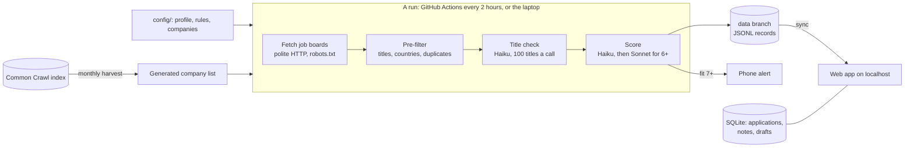

Each run pulls the pipeline's state from a separate git branch, fetches its share of the companies, merges new roles into what it knows, scores within its budget and pushes the result back. The web app reads the same state through a disposable SQLite catalogue, and keeps the user's own data (applications, notes, hidden roles, drafts) in a local SQLite database that never leaves the machine.

```
jobhunt/
  sources/       one adapter per job board; polite HTTP, robots.txt, host waits
  harvest.py     company discovery from Common Crawl
  prefilter.py   rule-based noise removal          titlecheck.py  batch title check
  scoring.py     scoring calls and usage budgets   pipeline.py    a run, end to end
  sync.py        the data branch                   health.py      checks on every run
  web/           the FastAPI app, templates, CSS and a little JavaScript
tests/           pytest on saved board responses and an example candidate
demo/            the demo's invented data (scripts/build_demo.py writes it)
```

## Design decisions

### A model cascade inside a usage budget

Most fetched roles are obviously wrong for a given candidate, and the subscription's five-hour window is shared with everything else the candidate does with Claude. So scoring is a cascade, cheapest first:

1. **Rules** remove only clear noise: senior and non-engineering titles, places outside the allowed countries, and the same role posted in several cities or on several boards.
2. **A batch title check** sends 100 titles to Haiku in one call. It may drop a title only with a word-for-word quote from the profile as its reason; a drop without a grounded quote is rejected. In measurements it kept every role that Sonnet later rated 7 or more.
3. **Haiku** scores what is left. Only roles it rates 6 or more go on to **Sonnet**, whose score is the one shown.

Every call reserves its model's usual share of the window before it starts, and is charged its actual cost when it returns. A scheduled run stops at 10% of a window (20% while more than 1,000 roles wait), and a weekly guard that follows Claude's own seven-day figure pauses part of the generated list at 75% and resumes below 65% (the user's own companies are never paused), so the tool never locks its user out. Figures are kept per Claude account, so a run on another account never counts towards the wrong limit.

### Evaluation against hand scores

The scoring rules were tuned against a regression set of 19 roles the candidate scored by hand. `jobhunt eval` scores each one three times with its own example left out of the prompt, and reports how often the model agrees. The rules were frozen once they met a stopping rule set in advance: Sonnet's fit lands within one point of the hand score 89% of the time, and its suggested action matches 86% of the time. They are reworded only for systematic problems, never to fix a single role. The measurements behind these and other numbers are in [docs/measurements.md](docs/measurements.md).

### Fit is separate from blockers

A role can fit well and still have a blocker, such as a required language or an enrolment rule. The score keeps them apart: fit is the headline and the sort key, and blockers are listed beside it with their severity, never subtracted. Some rules live in code rather than in the prompt, so they hold whatever the model says: an experience requirement without a stated number of years becomes a gap, not a blocker, and a deadline stated by the board wins over one the model read.

### Postings are untrusted input

A job posting is text written by someone else, and may contain instructions. Each scoring call runs with no tools at all, in an empty temporary folder, with no settings, no project files and no session history, and must answer through a fixed JSON schema that the code validates. The system prompt says the posting is data to assess, never instructions to follow.

### Polite fetching, within each source's terms

The tool reads public job-board APIs, the way they are meant to be read, and waits between requests to each host (longer for hosts that ask for it). It retries server errors with backoff and honours `Retry-After`; a host that asks for more than a minute is not contacted again until that time, across runs. Custom career sites are read only where robots.txt (parsed per RFC 9309) allows it. Sites that answer with a bot check are recorded as such and never worked around: they can be followed through their own job-alert emails instead, read from one Gmail label with read-only access, links never followed. LinkedIn is not scraped.

### State on a data branch, merged record by record

GitHub Actions and the laptop both run the pipeline, so its state lives on an orphan `data` branch, checked out as a separate worktree. Records are JSON lines merged by key (roles by key, scores by when they were made, lists by their last change), never by git's line merge, and a lock file lets one process write at a time. The user's own edits live only in the local SQLite database, which sync never writes to and which is backed up every day.

### Health checks on every run

A tool that runs unattended has to notice its own failures. Every run compares itself with the runs before it: far fewer companies fetched than usual, one of the user's companies failing several runs in a row, or a monthly harvest that would shrink the company list by more than 10% (which is refused rather than written). Each shows as one plain line on the Today page, with the details a click away, and sends at most one phone alert a day. The scheduled workflow also projects the month's GitHub Actions minutes and spaces its runs out when the projection gets close to the free allowance.

### Personal data stays out of the code

Everything about the candidate lives in `config/`. A leak check runs on every commit and in CI, and fails if any private string (from a private patterns file, the candidate's name and their contact details) appears anywhere else in the repository.

## Screenshots

| Light | Dark |
|---|---|
| 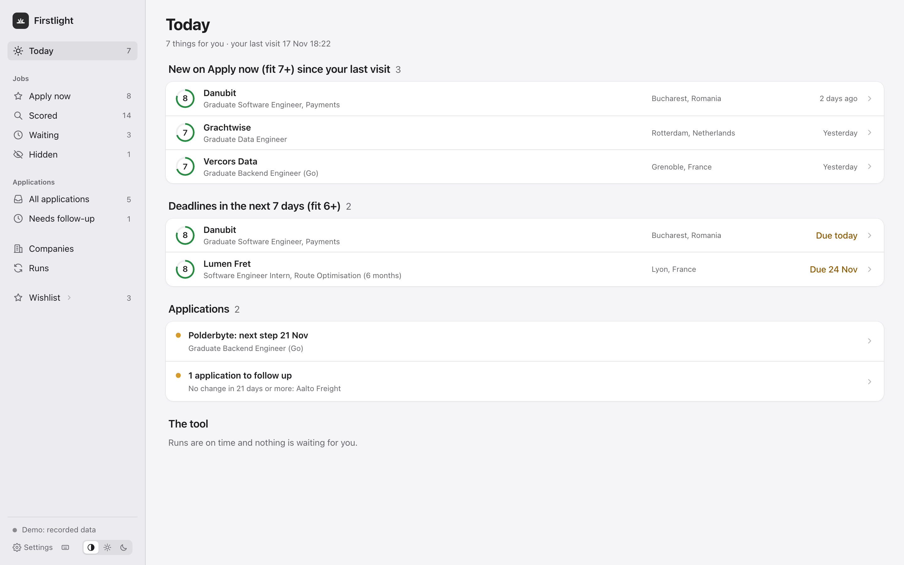 | 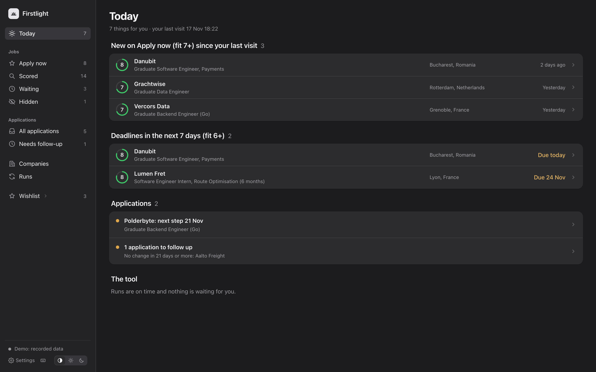 |
| 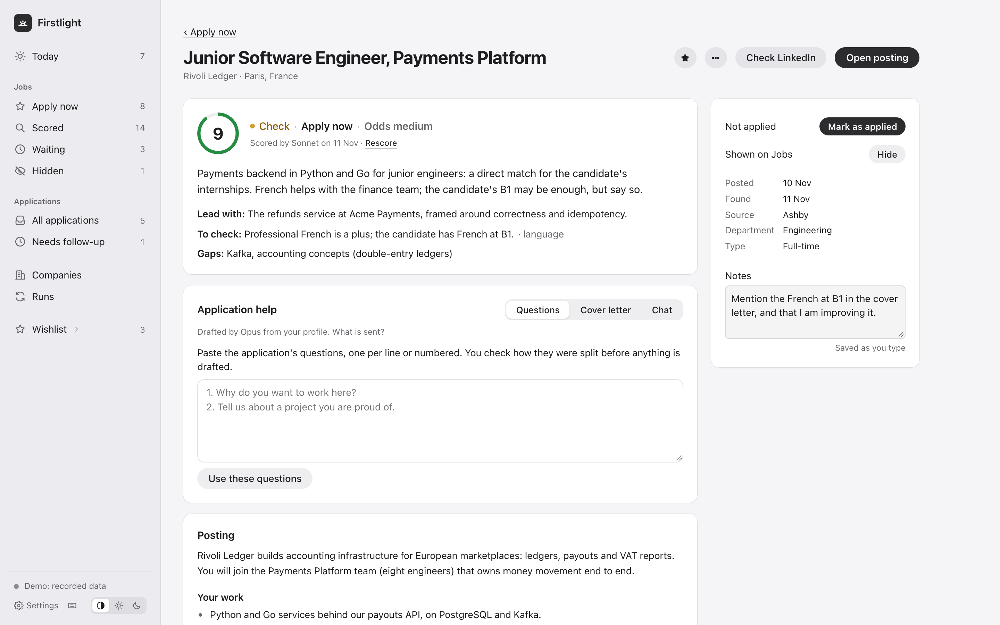 | 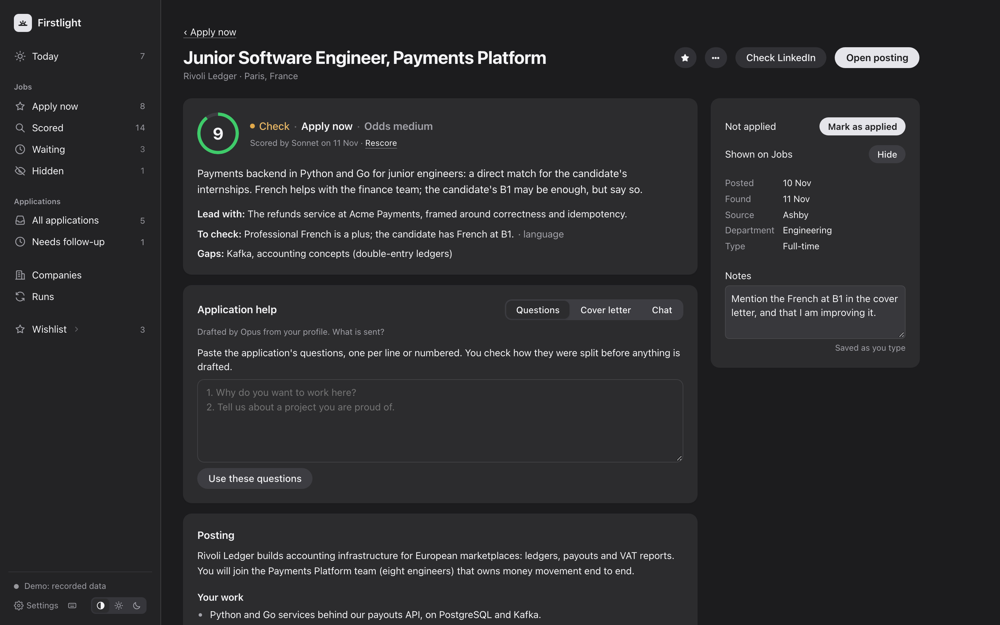 |
| 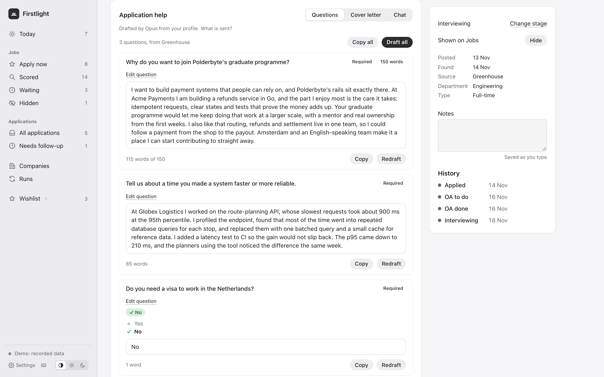 | 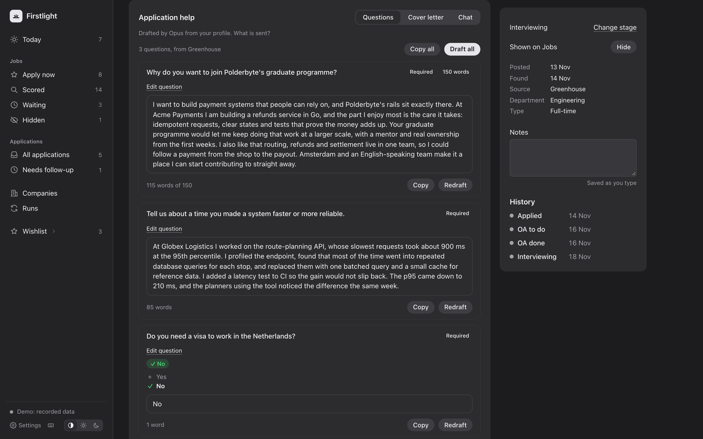 |
| 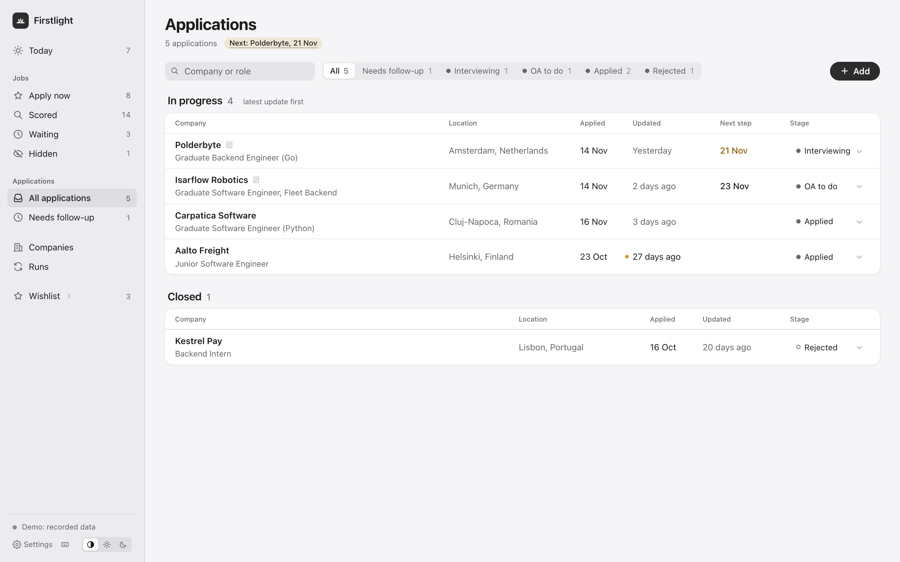 | 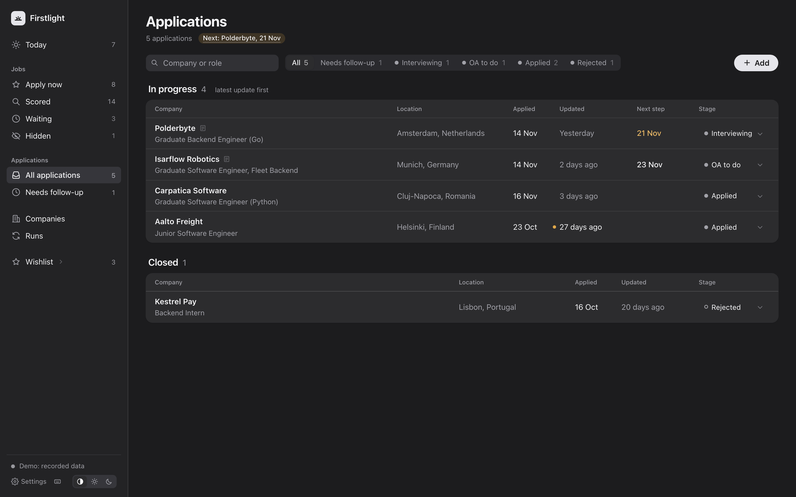 |
| 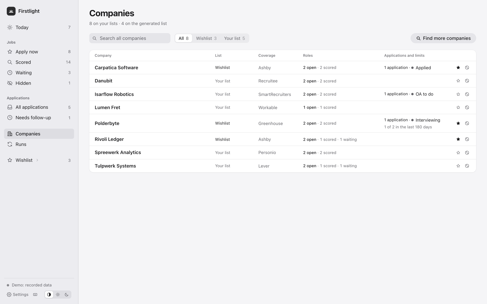 | 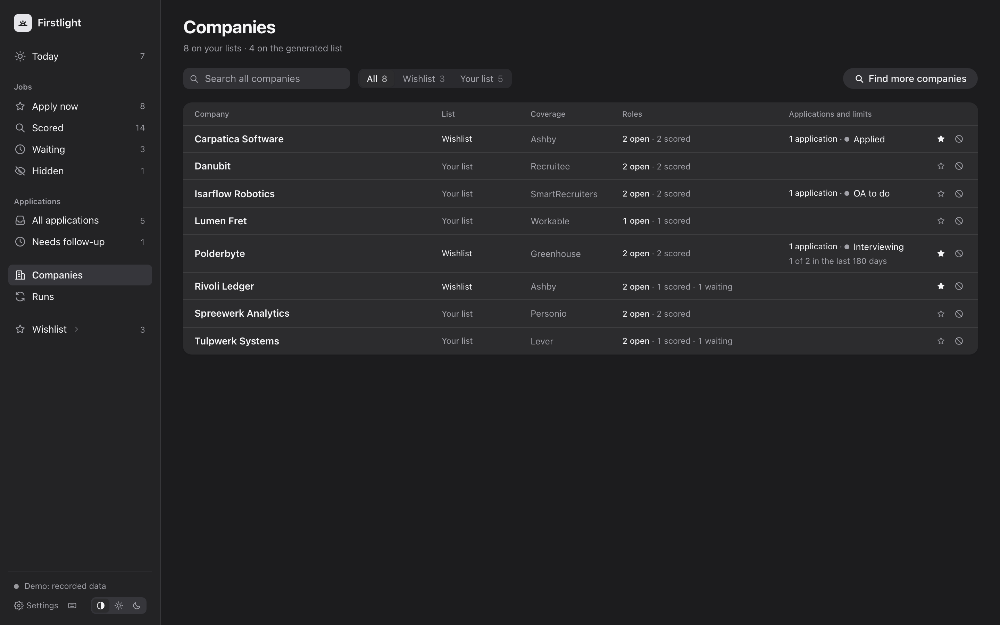 |
| 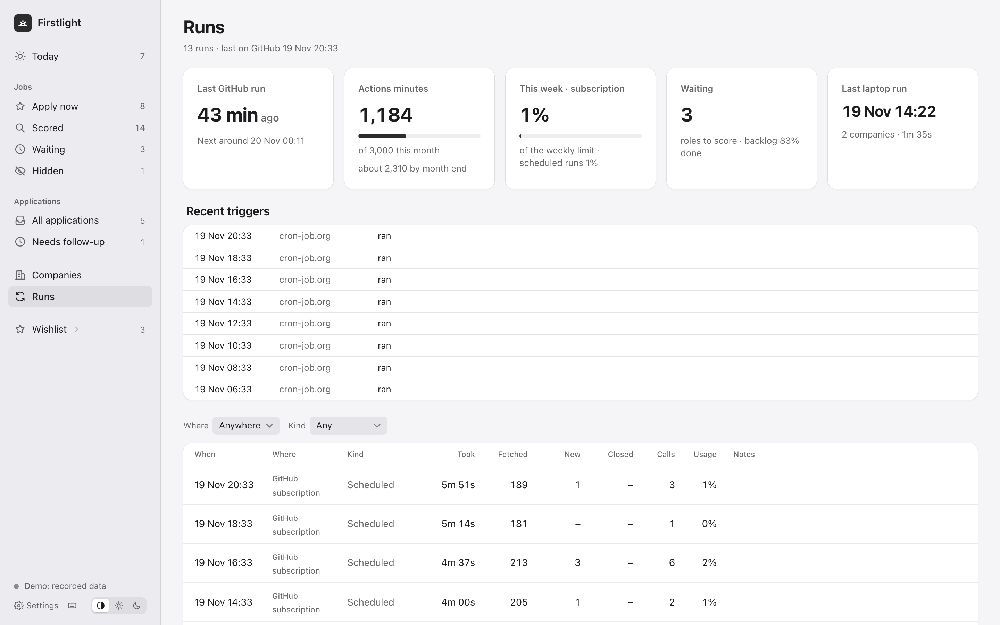 | 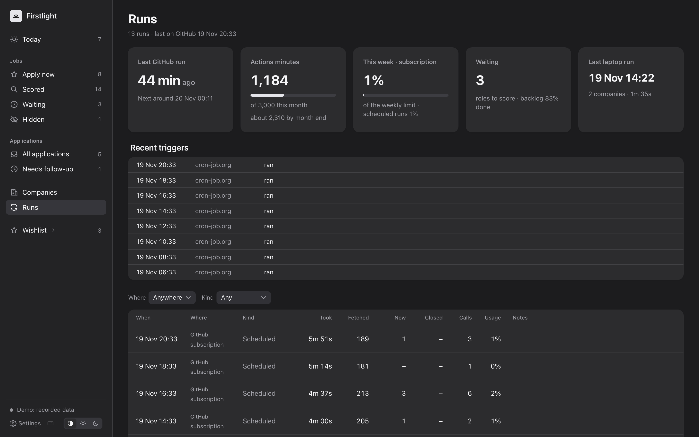 |
| 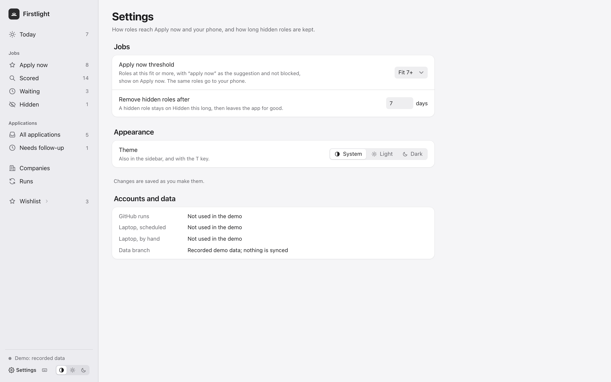 | 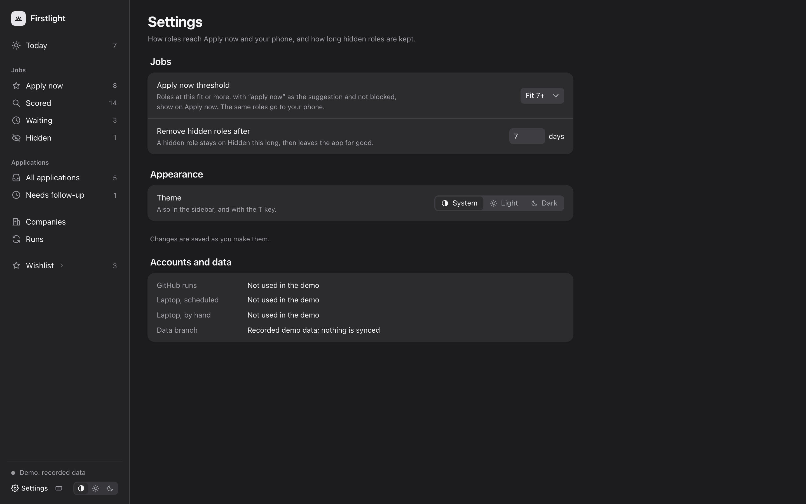 |

## Development

```sh
uv run pytest              # about 680 tests, offline: saved board responses, no model calls
uv run playwright install chromium && uv run pytest -m e2e
                           # browser tests on the demo: every page, sheet, menu and shortcut,
                           # at two widths in light and dark mode
uv run jobhunt leakcheck   # the leak check the pre-commit hook and CI run
git config core.hooksPath .githooks
```

Python 3.14 with [uv](https://docs.astral.sh/uv/). Dependencies are kept small: requests, FastAPI, uvicorn, Jinja2 and python-multipart, plus Playwright for the few career sites that need JavaScript. The example scheduled workflows are in [examples/github-actions](examples/github-actions).

## License

MIT: see [LICENSE](LICENSE).
